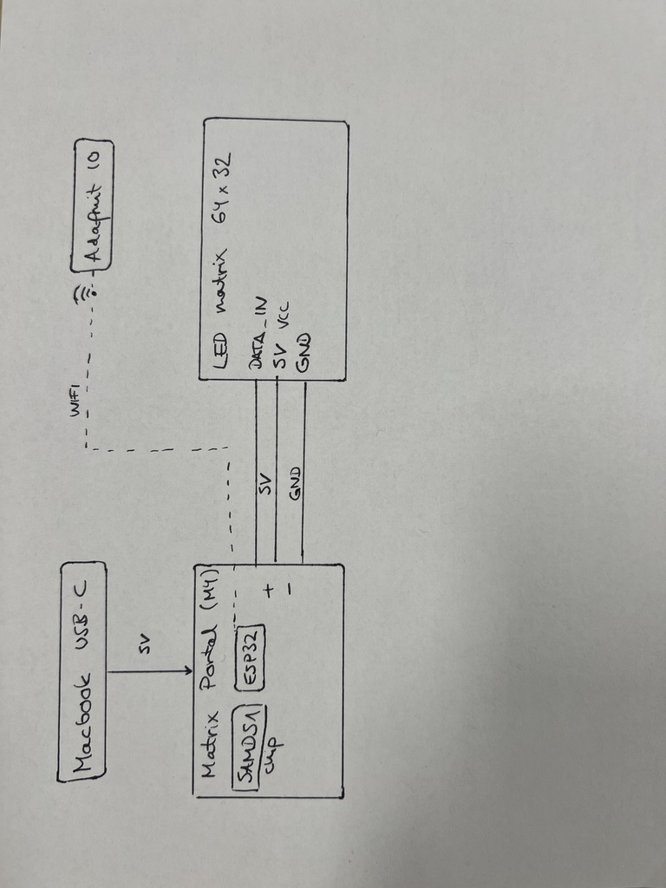
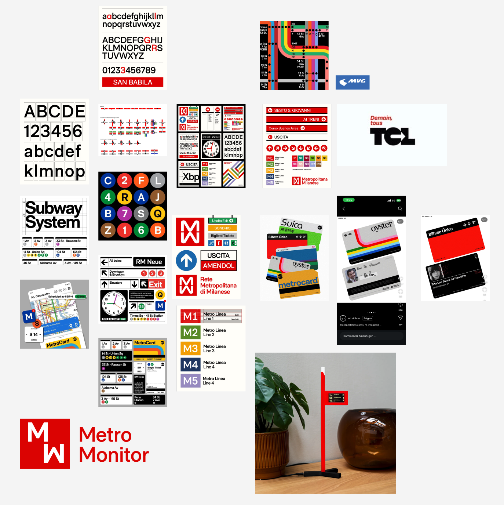
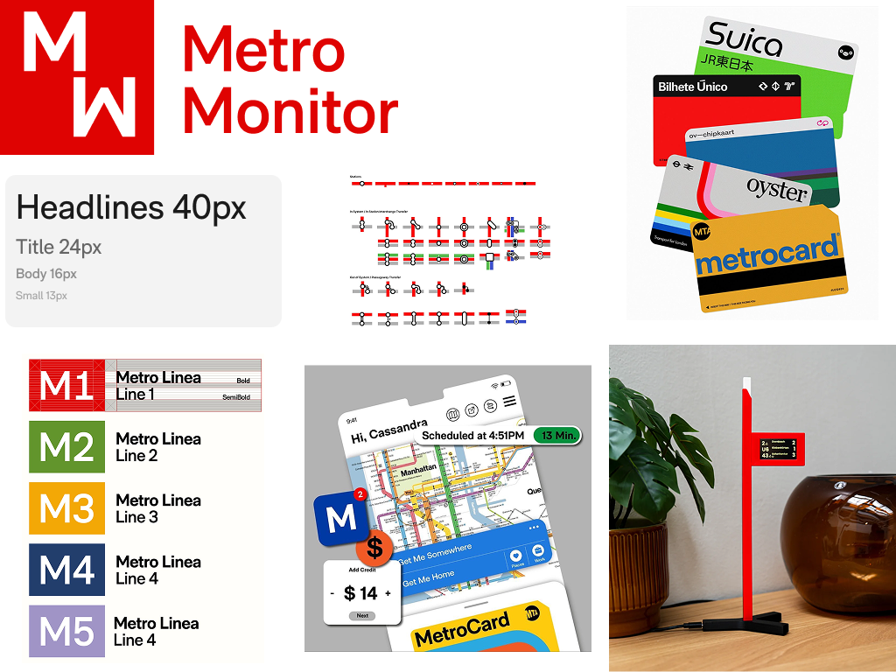
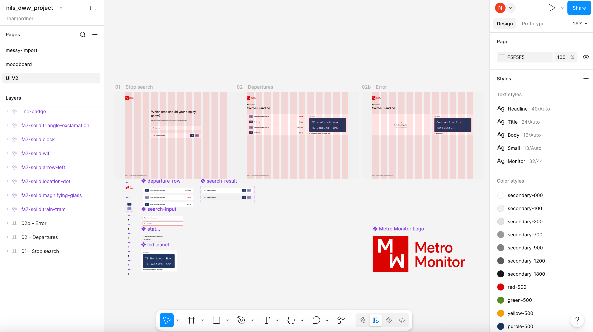
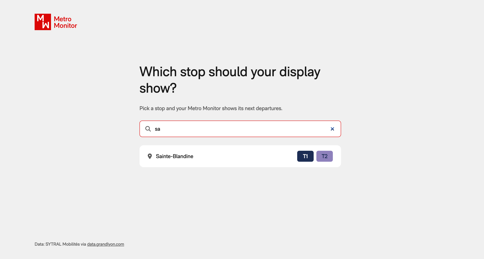

# Metro Monitor

Here is the table of contents of my submission:
- [Code of the electronic part↗](arduinoCode.ino)
- [Schematic view](#schematic-view)
- [Moodboard](#moodboard)
- [UI on Figma](#figma-ui)
- [Code of the web part↗](web-prototype/index.html)
- [Video](#video)

## Schematic view
<picture>
    
</picture>

This prototype uses an Adafruit Matrix Portal M4 (SAMD51 + ESP32 for Wi-Fi) plugged onto a 64×32 RGB LED matrix (Adafruit #2278). It is powered over USB-C from the laptop and receives the departures over Wi-Fi from Adafruit IO.

## Moodboard

<picture>
    
</picture>

<picture>
    
</picture>

## Figma UI

<picture>
    
</picture>

[Figma UI↗](https://www.figma.com/design/v5hait1ycPpq6KEsMheVlH/nils_dww_project?node-id=7-71&t=6ln5fj0bW8Jfrn2E-1)

## Web part
Here is a preview of the website.

<picture>
    
</picture>

## Video

[See the video on YouTube↗](https://youtu.be/e4FF9aRYUUM)